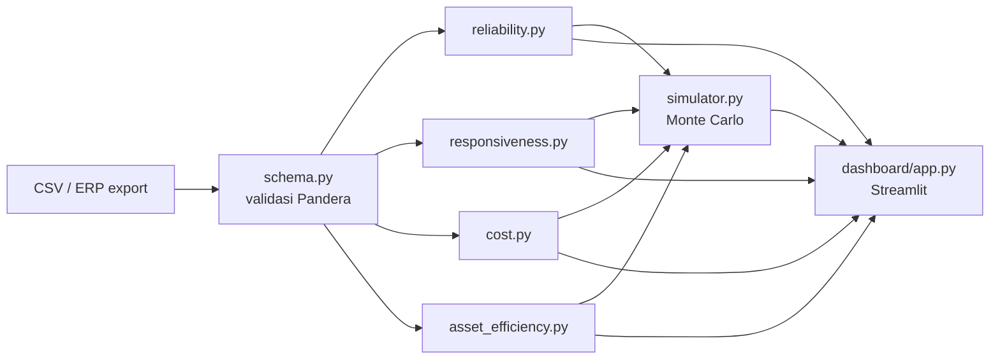

# 📦 SCOR-Py: Toolkit Metrik & Simulasi Rantai Pasok Berbasis Kerangka SCOR


-orange)


**SCOR-Py** adalah pustaka (*library*) Python dan *template* dasbor interaktif yang mengimplementasikan metrik kinerja dari kerangka kerja **SCOR (Supply Chain Operations Reference)** milik ASCM (sebelumnya APICS). Pustaka ini mengubah data transaksi mentah logistik, pengadaan (*procurement*), dan inventaris menjadi metrik kinerja rantai pasok yang konsisten, dapat diaudit, dan dapat direproduksi.

> **Disclaimer:** SCOR® adalah merek dagang terdaftar milik ASCM. SCOR-Py adalah proyek independen dan **tidak berafiliasi, disponsori, atau disahkan oleh ASCM**. Kode metrik (mis. RL.1.1) merujuk pada **SCOR Model 12.0**; padanannya pada *SCOR Digital Standard* (SCOR DS) perlu diverifikasi terhadap dokumen resmi ASCM.

## 📑 Daftar Isi

1. [Latar Belakang Masalah](#-latar-belakang-masalah)
2. [Tujuan & Non-Tujuan](#-tujuan--non-tujuan)
3. [Metrik yang Didukung](#-metrik-yang-didukung-scor-level-1--2)
4. [Arsitektur & Struktur Repositori](#-arsitektur--struktur-repositori)
5. [Instalasi](#-instalasi)
6. [Kamus Data (Data Dictionary)](#-kamus-data-data-dictionary)
7. [Contoh Penggunaan](#-contoh-penggunaan-api-design)
8. [Metodologi & Keputusan Desain](#-metodologi--keputusan-desain)
9. [What-If Simulator (Streamlit)](#-what-if-simulator-streamlit)
10. [Pengujian & Kualitas Kode](#-pengujian--kualitas-kode)
11. [Keterbatasan](#-keterbatasan)
12. [Peta Jalan](#-peta-jalan-pengembangan-roadmap)
13. [Kontribusi, Lisensi, dan Sitasi](#-kontribusi-lisensi-dan-sitasi)

---

## 🎯 Latar Belakang Masalah

Banyak proyek *Data Science* rantai pasok yang tersedia secara publik berfokus pada prediksi permintaan (*demand forecasting*) dengan model seperti ARIMA atau Prophet. Padahal, di industri (manufaktur, FMCG, *e-commerce*, distribusi), manajemen juga mengevaluasi **kinerja operasional** secara berkala, dan **SCOR** adalah salah satu kerangka acuan yang paling umum dipakai untuk itu.

Dalam praktiknya, metrik tersebut masih sering dihitung manual di Excel. Cara ini rawan kesalahan, sulit diaudit, dan lambat ketika data transaksi ERP mencapai ratusan ribu baris. Definisi juga sering berbeda antar analis (misalnya "tepat waktu" dihitung dengan atau tanpa toleransi), sehingga angka antar periode atau antar unit bisnis tidak dapat dibandingkan.

**SCOR-Py** menjembatani rekayasa data (*data engineering*) dan logika bisnis rantai pasok dengan:

* definisi metrik yang **eksplisit dan terdokumentasi**,
* **validasi data** sebelum perhitungan,
* hasil yang **dapat direproduksi** (kode + data sintetis + pengujian),
* simulasi **what-if** untuk mengubah angka historis menjadi keputusan.

## 🧭 Tujuan & Non-Tujuan

| Tujuan | Non-Tujuan |
|---|---|
| Menghitung metrik SCOR Level 1 & 2 dari log transaksi | Menggantikan sistem ERP/BI perusahaan |
| Menyediakan definisi metrik yang transparan dan dapat dikonfigurasi | Menjadi implementasi resmi/tersertifikasi SCOR |
| Mendukung analisis per segmen (pelanggan, pemasok, produk, periode) | Peramalan permintaan (*forecasting*) |
| Simulasi skenario sederhana berbasis Monte Carlo | Optimasi jaringan distribusi skala penuh |

## 📊 Metrik yang Didukung (SCOR Level 1 & 2)

Pustaka ini mengelompokkan kalkulasi ke dalam 5 atribut kinerja SCOR.

| Atribut | Kode | Metrik | Status |
|---|---|---|---|
| Reliability | RL.1.1 | Perfect Order Fulfillment (POF) | ✅ v0.1.0 |
| Reliability | – | OTIF, On-Time, In-Full, Damage-Free, Doc-Accurate | ✅ v0.1.0 |
| Responsiveness | RS.1.1 | Order Fulfillment Cycle Time (OFCT) | 🛠 v0.2.0 |
| Agility | AG.1.1 | Upside Supply Chain Flexibility | 🗓 v0.4.0 |
| Costs | CO.1.1 | Total Supply Chain Management Cost | 🛠 v0.2.0 |
| Asset Mgmt. Efficiency | AM.1.1 | Cash-to-Cash Cycle Time | ✅ v0.1.0 |
| Asset Mgmt. Efficiency | AM.1.2 | Return on Supply Chain Fixed Assets | 🗓 v0.4.0 |
| Asset Mgmt. Efficiency | AM.1.3 | Return on Working Capital | 🗓 v0.4.0 |

### 1. Reliability (Keandalan)

* **Perfect Order Fulfillment (RL.1.1):** persentase pesanan yang dikirim **tepat waktu, lengkap, tanpa kerusakan, dan dengan dokumentasi akurat**. Sebuah pesanan dianggap sempurna hanya jika **keempat** kondisi terpenuhi sekaligus.

  $$\text{POF} = \frac{\text{Pesanan sempurna}}{\text{Total pesanan dikirim}} \times 100\%$$

* **OTIF (On-Time In-Full):** persentase pesanan yang **sekaligus** tepat waktu dan lengkap (irisan, bukan perkalian dua persentase terpisah).

  $$\text{OTIF} = \frac{|\text{On-Time} \cap \text{In-Full}|}{\text{Total pesanan dikirim}} \times 100\%$$

**Hubungan yang selalu berlaku** (dipakai sebagai uji invarian, lihat [Pengujian](#-pengujian--kualitas-kode)):

$$\text{POF} \le \text{OTIF} \le \min(\text{On-Time},\ \text{In-Full})$$

### 2. Responsiveness (Kecepatan Respon)

* **Order Fulfillment Cycle Time (RS.1.1):** rata-rata waktu aktual dari pesanan diterima hingga barang diterima pelanggan. Pada SCOR, ini merupakan agregasi siklus *Source*, *Make*, dan *Deliver*:

  $$\text{OFCT} = T_{\text{Source}} + T_{\text{Make}} + T_{\text{Deliver}}$$

  Bila data tahap-tahap tersebut tidak tersedia, SCOR-Py menghitung pendekatan *end-to-end*: `actual_delivery_date − order_date`, dan melaporkan rata-rata, median, serta persentil ke-90 (karena distribusi *lead time* biasanya miring ke kanan).

### 3. Agility (Ketangkasan)

* **Upside Supply Chain Flexibility (AG.1.1):** jumlah hari yang dibutuhkan untuk mencapai **peningkatan kuantitas pengiriman yang tidak direncanakan dan berkelanjutan sebesar 20%**. Dalam SCOR-Py, metrik ini diestimasi melalui simulasi (modul `simulator.py`), bukan dari data transaksi saja.

### 4. Costs (Biaya)

* **Total Supply Chain Management Cost (CO.1.1):** agregasi biaya yang terkait proses *Plan, Source, Make, Deliver,* dan *Return*. Pada implementasi ini mencakup biaya pengadaan, penyimpanan inventaris, transportasi, pengembalian (*reverse logistics*), serta biaya perencanaan/produksi bila tersedia. Hasil dilaporkan dalam nilai absolut **dan** sebagai persentase terhadap pendapatan:

  $$\text{SCM Cost \%} = \frac{\text{Total biaya SCM}}{\text{Pendapatan}} \times 100\%$$

### 5. Asset Management Efficiency (Efisiensi Aset)

* **Cash-to-Cash Cycle Time (AM.1.1):** waktu sejak kas keluar untuk membayar pemasok hingga kas masuk dari pelanggan.

  $$\text{C2C} = \text{IDS} + \text{DSO} - \text{DPO}$$

  | Komponen | Rumus default | Catatan |
  |---|---|---|
  | **IDS** (Inventory Days of Supply) | $\dfrac{\text{Rata-rata persediaan}}{\text{COGS}} \times 365$ | |
  | **DSO** (Days Sales Outstanding) | $\dfrac{\text{Piutang dagang}}{\text{Pendapatan}} \times 365$ | |
  | **DPO** (Days Payable Outstanding) | $\dfrac{\text{Utang dagang}}{\text{COGS}} \times 365$ | Sebagian perusahaan memakai pembelian (*purchases*) sebagai penyebut; dapat dikonfigurasi |

* **Return on Supply Chain Fixed Assets (AM.1.2)** dan **Return on Working Capital (AM.1.3):**

  $$\text{AM.1.2} = \frac{\text{Pendapatan SC} - \text{COGS} - \text{Biaya SCM}}{\text{Aset tetap rantai pasok}}$$

  $$\text{AM.1.3} = \frac{\text{Pendapatan SC} - \text{COGS} - \text{Biaya SCM}}{\text{Persediaan} + \text{Piutang} - \text{Utang}}$$

## 🏗️ Arsitektur & Struktur Repositori

Struktur ini memisahkan *core calculation engine* (dapat diinstal via `pip`) dari aplikasi visualisasi dasbor, sehingga mesin hitung bisa dipakai di *notebook*, *pipeline* batch, atau aplikasi lain tanpa dependensi UI.



```
scor-py/
├── data/
│   ├── sample_orders.csv          # Data sintetis pesanan & pengiriman (ERP log)
│   ├── sample_inventory.csv       # Data level stok harian & COGS
│   └── sample_financials.csv      # Data AR, AP, dan biaya logistik
├── scorpy/
│   ├── __init__.py
│   ├── schema.py                  # Validasi kolom DataFrame (Pandera)
│   ├── reliability.py             # POF, OTIF, On-Time, In-Full, Damage-Free
│   ├── responsiveness.py          # Cycle Time & Lead Time
│   ├── asset_efficiency.py        # Cash-to-Cash, DSO, DPO, IDS
│   ├── cost.py                    # Analisis biaya logistik & COGS
│   └── simulator.py               # Simulasi Monte Carlo untuk bottleneck
├── dashboard/
│   ├── app.py                     # Aplikasi interaktif Streamlit
│   └── components/                # Komponen Plotly (Waterfall, Gauge, Sankey)
├── notebooks/
│   ├── 01_scor_metrics_tutorial.ipynb
│   └── 02_bottleneck_simulation.ipynb
├── tests/
│   ├── test_reliability.py
│   ├── test_asset_efficiency.py
│   └── test_invariants.py         # Uji berbasis properti (Hypothesis)
├── docs/                          # Dokumentasi metodologi (MkDocs, opsional)
├── pyproject.toml
├── README.md
├── LICENSE
└── requirements.txt
```

## ⚙️ Instalasi & Penggunaan

Prasyarat: **Python 3.10+**.

```bash
# Dari sumber (pengembangan)
git clone https://github.com/nazaa-arch/Scor-py.git
cd Scor-py
python -m venv .venv && source .venv/bin/activate   # Windows: .venv\Scripts\activate
pip install -e ".[dev,dashboard]"

# Menjalankan dasbor Streamlit interaktif
streamlit run dashboard/app.py

# Atau menggunakan Docker (satu perintah)
docker compose up
```

### 💻 Command-Line Interface (CLI)

SCOR-Py menyediakan antarmuka CLI `scorpy` untuk analisis batch tanpa perlu membuka dashboard atau notebook:

```bash
# Evaluasi metrik Reliability & Responsiveness
scorpy evaluate-orders --data data/sample_orders.csv

# Evaluasi dikelompokkan berdasarkan segmen pelanggan (format JSON)
scorpy evaluate-orders --data data/sample_orders.csv --group-by customer_segment --format json

# Hitung Cash-to-Cash Cycle Time (AM.1.1)
scorpy evaluate-c2c --cogs 15000000000 --revenue 22500000000 --inventory 2100000000 --ar 1800000000 --ap 1400000000

# Jalankan simulasi Monte Carlo gangguan keterlambatan pemasok
scorpy simulate --data data/sample_orders.csv --lead-shift 3 --runs 1000
```

> Paket belum dipublikasikan ke PyPI. Setelah dirilis, instalasi cukup dengan `pip install scor-py` (nama paket) dan `import scorpy` (nama modul).

## 🗂️ Kamus Data (Data Dictionary)

Nama kolom bersifat **dapat dipetakan** (lihat parameter `*_col`), sehingga data ERP apa pun dapat dipakai tanpa mengganti nama kolom.

**`sample_orders.csv`** (granularitas: satu baris per pesanan)

| Kolom | Tipe | Wajib | Aturan validasi |
|---|---|---|---|
| `so_number` | string | ✅ | unik |
| `order_date` | date | ✅ | ≤ `actual_delivery_date` |
| `promised_delivery_date` | date | ✅ | ≥ `order_date` |
| `actual_delivery_date` | date | ✅ | tidak boleh kosong untuk pesanan terkirim |
| `qty_ordered` | int | ✅ | > 0 |
| `qty_delivered` | int | ✅ | ≥ 0 |
| `is_damaged` | bool | ✅ | – |
| `is_doc_complete` | bool | ✅ | – |

**`sample_financials.csv`**

| Kolom | Tipe | Keterangan |
|---|---|---|
| `period` | string (YYYY-MM) | periode pelaporan |
| `revenue`, `cogs` | float | dalam mata uang yang sama (mis. Rp) |
| `accounts_receivable`, `accounts_payable` | float | saldo akhir periode |
| `transport_cost`, `warehousing_cost`, `procurement_cost`, `return_cost` | float | komponen biaya SCM |

**`sample_inventory.csv`**

| Kolom | Tipe | Keterangan |
|---|---|---|
| `date` | date | tanggal pencatatan harian |
| `sku` | string | kode barang |
| `on_hand_qty` | int | stok fisik |
| `unit_cost` | float | biaya per unit |

## 🚀 Contoh Penggunaan (API Design)

Dirancang agar terintegrasi dengan **Pandas** dan, pada v1.0, **Polars**. Seluruh nilai pada contoh keluaran di bawah bersifat **ilustratif**, berasal dari data sintetis.

### 1. Menghitung *Perfect Order Fulfillment* & *OTIF*

```python
import pandas as pd
from scorpy.reliability import ReliabilityMetrics

df_orders = pd.read_csv(
    "data/sample_orders.csv",
    parse_dates=["order_date", "promised_delivery_date", "actual_delivery_date"],
)

rel = ReliabilityMetrics(
    data=df_orders,
    order_id_col="so_number",
    promised_date_col="promised_delivery_date",
    actual_date_col="actual_delivery_date",
    ordered_qty_col="qty_ordered",
    delivered_qty_col="qty_delivered",
    damaged_flag_col="is_damaged",
    doc_accurate_col="is_doc_complete",
    on_time_grace_days=0,  # toleransi keterlambatan (hari)
    in_full_tolerance=0.0,  # toleransi kekurangan kuantitas (0.02 = 2%)
)

summary = rel.evaluate_all()
print(summary)
# {
#   'On_Time_rate': 0.910,
#   'In_Full_rate': 0.885,
#   'OTIF_rate': 0.842,
#   'Damage_Free_rate': 0.992,
#   'Doc_Accurate_rate': 0.975,
#   'Perfect_Order_Fulfillment': 0.815
# }

# Pecah per segmen untuk mencari akar masalah
by_customer = rel.evaluate_all(group_by="customer_segment")
```

### 2. Menghitung *Cash-to-Cash Cycle Time*

```python
from scorpy.asset_efficiency import AssetMetrics

assets = AssetMetrics(
    annual_cogs=15_000_000_000,  # Rp 15 miliar
    annual_revenue=22_500_000_000,  # Rp 22,5 miliar
    avg_inventory_value=2_100_000_000,  # Rp 2,1 miliar
    accounts_receivable=1_800_000_000,  # Piutang dagang
    accounts_payable=1_400_000_000,  # Utang dagang ke pemasok
    days_in_year=365,
)

c2c = assets.cash_to_cash_cycle()
print(f"IDS: {c2c['IDS']:.1f} hari")  # 51.1 hari
print(f"DSO: {c2c['DSO']:.1f} hari")  # 29.2 hari
print(f"DPO: {c2c['DPO']:.1f} hari")  # 34.1 hari
print(f"Cash-to-Cash Cycle Time: {c2c['C2C_days']:.1f} hari")  # 46.2 hari
```

Perhitungan manual untuk verifikasi: IDS = 2,1/15 × 365 = 51,1; DSO = 1,8/22,5 × 365 = 29,2; DPO = 1,4/15 × 365 = 34,1; maka C2C = 51,1 + 29,2 − 34,1 ≈ **46,2 hari**. Contoh ini juga dipakai sebagai *golden test*.

### 3. Menghitung *Order Fulfillment Cycle Time*

```python
from scorpy.responsiveness import ResponsivenessMetrics

resp = ResponsivenessMetrics(
    data=df_orders,
    order_date_col="order_date",
    actual_date_col="actual_delivery_date",
)
print(resp.order_fulfillment_cycle_time())
# {'mean_days': 6.8, 'median_days': 6.0, 'p90_days': 11.0}
```

### 4. Simulasi *What-If*

```python
from scorpy.simulator import SupplyChainSimulator

sim = SupplyChainSimulator.from_orders(df_orders, seed=42)
result = sim.run(
    n_runs=10_000,
    scenario={"supplier_lead_time_shift_days": +3},
)
print(result.compare_to_baseline("OTIF_rate"))  # selisih OTIF + interval kepercayaan 95%
```

## 🔬 Metodologi & Keputusan Desain

Keputusan berikut memengaruhi angka yang dihasilkan, sehingga dibuat **eksplisit dan dapat diubah**:

| Isu | Keputusan default | Alasan |
|---|---|---|
| Definisi "tepat waktu" | `actual_date <= promised_date + grace_days` (grace default 0) | Sesuai komitmen awal kepada pelanggan |
| Definisi "lengkap" | `qty_delivered >= qty_ordered × (1 − tolerance)` | Pengiriman berlebih dianggap lengkap; toleransi opsional |
| Pengiriman parsial | Pesanan dinilai pada tanggal pengiriman **terakhir** | Pesanan baru "terpenuhi" saat semua kuantitas tiba |
| Granularitas | Per pesanan (opsi per baris pesanan/*order line*) | Konsisten dengan definisi RL.1.1 |
| Pesanan dibatalkan / belum terkirim | Dikeluarkan dari penyebut, dan jumlahnya dilaporkan terpisah | Mencegah bias ke bawah atau ke atas |
| Data tidak valid (tanggal terbalik, kuantitas negatif) | Gagal cepat (*fail fast*) di `schema.py` | Hasil salah lebih berbahaya daripada galat |
| Saldo akun (AR/AP/persediaan) | Rata-rata periode bila tersedia; saldo akhir bila tidak | Rata-rata lebih representatif; saldo akhir tetap valid sebagai pendekatan |
| Hari dalam setahun | 365 (dapat diubah ke 360) | Praktik berbeda antar perusahaan |

## 🖥️ What-If Simulator (Streamlit)

Aplikasi `dashboard/app.py` memungkinkan manajer rantai pasok menjalankan analisis skenario tanpa menulis kode:

* *"Jika waktu tunggu pemasok (Supplier Lead Time) mundur 3 hari, berapa persen penurunan OTIF bulan depan?"*
  Simulator mengambil sampel distribusi keterlambatan historis per pemasok, menggeser distribusi sebesar +3 hari, lalu menghitung ulang OTIF pada ribuan replikasi Monte Carlo dan melaporkan **rentang ketidakpastian**, bukan hanya satu angka.
* *"Jika stok pengaman (Safety Stock) diturunkan 15%, berapa modal kerja yang dapat dihemat dan bagaimana dampaknya pada Cash-to-Cash?"*
  Penghematan modal kerja = penurunan nilai persediaan; dampak ke IDS = $\Delta\text{Persediaan} / \text{COGS} \times 365$. Dampak sampingan berupa kenaikan risiko *stockout* ditampilkan melalui simulasi OTIF/In-Full.

  *Contoh ilustratif:* jika stok pengaman mewakili 40% dari persediaan rata-rata Rp 2,1 miliar, penurunan 15% membebaskan sekitar Rp 126 juta modal kerja dan memangkas IDS sekitar 3,1 hari pada data contoh di atas.

Visualisasi: *gauge* untuk lima atribut SCOR, *waterfall* untuk dekomposisi C2C dan biaya, serta *Sankey* untuk aliran penyebab keterlambatan.

## ✅ Pengujian & Kualitas Kode

* **Unit test** (`pytest`) untuk tiap modul metrik, termasuk *golden test* C2C = 46,2 hari.
* **Uji berbasis properti** (`hypothesis`) untuk invarian: `POF ≤ OTIF ≤ min(On-Time, In-Full)`, semua rasio berada di [0, 1], dan hasil tidak bergantung pada urutan baris.
* **Kasus tepi:** data kosong, satu pesanan, seluruh pesanan sempurna, seluruh pesanan gagal, pembagian dengan nol (COGS = 0).
* **Kualitas:** `ruff` (lint + format), `mypy` (tipe), `pre-commit`, dan CI GitHub Actions pada Python 3.10–3.12.
* **Reproduktibilitas:** semua simulasi menerima parameter `seed`.

```bash
pytest -q --cov=scorpy
ruff check . && mypy scorpy
```

## ⚠️ Keterbatasan

* Metrik dihitung dari data transaksi yang diberikan; **kualitas data input menentukan kualitas hasil**.
* Data sintetis pada `data/` hanya untuk demonstrasi dan tidak merepresentasikan perusahaan tertentu.
* Simulator Monte Carlo mengasumsikan distribusi historis tetap berlaku. Ia tidak menangkap gangguan struktural (mis. penutupan pelabuhan).
* Cakupan baru Level 1–2; metrik Level 3 dan atribut baru pada SCOR DS (mis. keberlanjutan) belum didukung.
* Implementasi ini **bukan** pengganti penilaian SCOR resmi atau sertifikasi.

## 🗺️ Peta Jalan Pengembangan (Roadmap)

* [x] **v0.1.0 (MVP):** Modul dasar *Reliability* (POF, OTIF) dan *Asset Efficiency* (C2C) berbasis Pandas, beserta dataset sintetis ERP.
* [ ] **v0.2.0:** Validasi skema otomatis dengan `Pandera` (tipe tanggal, kuantitas negatif, tanggal terbalik); modul *Responsiveness* (OFCT) dan *Cost* (CO.1.1); parameter toleransi *on-time* / *in-full*.
* [ ] **v0.3.0:** Simulator Monte Carlo dan dasbor Streamlit interaktif dengan *root-cause analysis* keterlambatan pengiriman.
* [ ] **v0.4.0:** Metrik *Agility* (AG.1.1) serta *Return on Fixed Assets* dan *Return on Working Capital* (AM.1.2, AM.1.3).
* [ ] **v1.0.0:** Dukungan *backend* **Polars / DuckDB** untuk jutaan baris log transaksi, API stabil dengan jaminan kompatibilitas versi, dokumentasi MkDocs, dan rilis ke PyPI.

## 🤝 Kontribusi, Lisensi, dan Sitasi

* **Kontribusi:** *fork* repositori, buat *branch* fitur, pastikan `pytest`, `ruff`, dan `mypy` lulus, lalu ajukan *pull request*. Isu yang diberi label `good first issue` cocok untuk kontributor baru.
* **Lisensi:** MIT (lihat `LICENSE`).
* **Sitasi:** bila dipakai dalam karya akademik, kutip repositori ini dan rujukan resmi SCOR Model 12.0 dari ASCM.

  ```bibtex
  @software{scorpy,
    title  = {SCOR-Py: Supply Chain Metrics and Simulation Toolkit},
    author = {<Nama Penulis>},
    year   = {2026},
    url    = {https://github.com/<username>/scor-py}
  }
  ```
