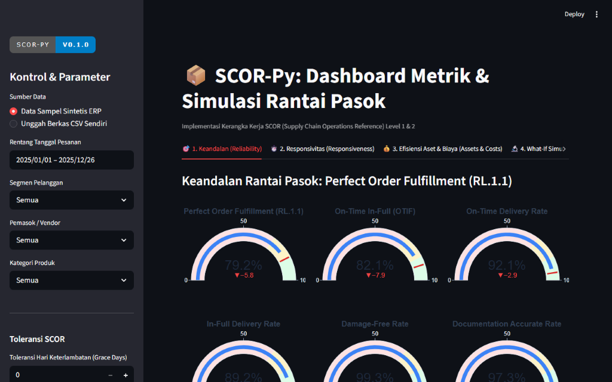
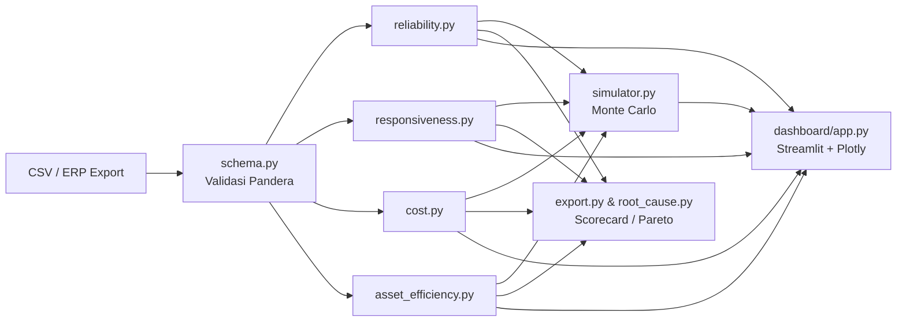

<div align="center">

<h1>📦 SCOR-Py</h1>

### Supply Chain Performance Metrics &amp; Monte Carlo What-If Simulation Toolkit (ASCM SCOR Framework)

Transform raw ERP logistics, procurement, and inventory logs into auditable SCOR Level 1 &amp; 2 KPIs, Pandera-validated datasets, and interactive Streamlit simulations.
Built for supply chain analysts, operations engineers, and Data Science workflows that need reproducible metrics beyond manual spreadsheets.

<br>

[](pyproject.toml)
[](https://python.org)
[](dashboard/app.py)
[](tests/)
[](scorpy/)
[](LICENSE)

[**Quickstart**](#quickstart) · [**Screens**](#screens) · [**Metrik SCOR**](#metrik-yang-didukung-scor-level-1--2) · [**Arsitektur**](#arsitektur--struktur-repositori) · [**API &amp; CLI**](#contoh-penggunaan-api-design) · [**Simulator**](#what-if-simulator-streamlit) · [**Support**](#support)

</div>

---

## What SCOR-Py is

**SCOR-Py** adalah pustaka (*library*) Python, antarmuka CLI (`scorpy`), dan dasbor interaktif **Streamlit + Plotly** yang mengimplementasikan metrik kinerja dari kerangka kerja **SCOR (Supply Chain Operations Reference)**. Pustaka ini menjembatani *data engineering* dan logika operasional rantai pasok dengan validasi skema ketat (**Pandera**), definisi metrik yang eksplisit, serta simulasi skenario **Monte Carlo** yang dapat direproduksi.

**Bukan sekadar *spreadsheet* atau *demand forecasting*.** Setiap metrik diuji dengan *golden tests* dan uji properti (`hypothesis`), sehingga definisi seperti *Perfect Order Fulfillment* (POF), *OTIF*, dan *Cash-to-Cash Cycle Time* konsisten antar periode dan unit bisnis.

> **Ingin lihat implementasi visual &amp; detail kode?** Jelajahi [`scorpy/`](scorpy/), [`dashboard/app.py`](dashboard/app.py), dan [notebook tutorial](notebooks/).

---

## Screens

<div align="center">

<br>
*Dasbor Streamlit SCOR-Py: filter segmen/pemasok/periode, 6 metrik keandalan (POF, OTIF, On-Time, In-Full, Damage-Free, Doc-Accurate), dan tab simulasi What-If.*

</div>

---

## 🎯 Latar Belakang &amp; Cakupan

Dalam praktik industri (manufaktur, FMCG, *e-commerce*, distribusi), metrik kinerja operasional sering masih dihitung manual di Excel sehingga rawan galat, lambat pada ratusan ribu baris ERP, dan rentan beda definisi antar analis (mis. apakah "tepat waktu" memakai toleransi atau tidak).

| Tujuan | Non-Tujuan |
|---|---|
| Menghitung metrik SCOR Level 1 &amp; 2 dari log transaksi ERP | Menggantikan sistem ERP/BI perusahaan |
| Menyediakan definisi metrik yang transparan dan dapat dikonfigurasi | Menjadi implementasi resmi/tersertifikasi ASCM SCOR |
| Mendukung analisis per segmen (pelanggan, pemasok, produk, periode) | Peramalan permintaan (*demand forecasting*) |
| Simulasi skenario *what-if* berbasis Monte Carlo | Optimasi jaringan distribusi skala penuh |

---

## 📊 Metrik yang Didukung (SCOR Level 1 &amp; 2)

Pustaka ini mengelompokkan kalkulasi ke dalam 5 atribut kinerja SCOR:

| Atribut | Kode | Metrik | Status |
|---|---|---|---|
| Reliability | `RL.1.1` | Perfect Order Fulfillment (POF) | ✅ Tersedia (`v0.1.0`) |
| Reliability | – | OTIF, On-Time, In-Full, Damage-Free, Doc-Accurate | ✅ Tersedia (`v0.1.0`) |
| Responsiveness | `RS.1.1` | Order Fulfillment Cycle Time (OFCT) | ✅ Tersedia (`v0.1.0`) |
| Agility | `AG.1.1` | Upside Supply Chain Flexibility &amp; Monte Carlo Simulator | ✅ Tersedia (`v0.1.0`) |
| Costs | `CO.1.1` | Total Supply Chain Management Cost | ✅ Tersedia (`v0.1.0`) |
| Asset Mgmt. Efficiency | `AM.1.1` | Cash-to-Cash Cycle Time (`IDS + DSO - DPO`) | ✅ Tersedia (`v0.1.0`) |
| Asset Mgmt. Efficiency | `AM.1.2` / `AM.1.3` | Return on Fixed Assets &amp; Working Capital | ✅ Tersedia (`v0.1.0`) |

### 1. Reliability (Keandalan)

* **Perfect Order Fulfillment (RL.1.1):** persentase pesanan yang dikirim **tepat waktu, lengkap, tanpa kerusakan, dan dengan dokumentasi akurat** secara bersamaan:

  $$\text{POF} = \frac{\text{Pesanan sempurna}}{\text{Total pesanan dikirim}} \times 100\%$$

* **OTIF (On-Time In-Full):** persentase pesanan yang **sekaligus** tepat waktu dan lengkap (irisan, bukan perkalian):

  $$\text{OTIF} = \frac{|\text{On-Time} \cap \text{In-Full}|}{\text{Total pesanan dikirim}} \times 100\%$$

  **Invarian yang selalu diuji:** $\text{POF} \le \text{OTIF} \le \min(\text{On-Time},\ \text{In-Full})$.

### 2. Responsiveness (`RS.1.1`) &amp; 3. Agility (`AG.1.1`)

* **Order Fulfillment Cycle Time (`RS.1.1`):** agregasi siklus *Source + Make + Deliver* atau pendekatan *end-to-end* (`actual_delivery_date − order_date`) dengan statistik mean, median, dan P90.
* **Upside Supply Chain Flexibility (`AG.1.1`):** estimasi ketahanan dan dampak skenario gangguan melalui `SupplyChainSimulator` berbasis Monte Carlo.

### 4. Costs (`CO.1.1`) &amp; 5. Asset Management Efficiency (`AM.1.1`–`AM.1.3`)

* **Total SCM Cost (`CO.1.1`):** agregasi biaya pengadaan, penyimpanan, transportasi, serta *reverse logistics* beserta persentasenya terhadap pendapatan.
* **Cash-to-Cash Cycle Time (`AM.1.1`):** $\text{C2C} = \text{IDS} + \text{DSO} - \text{DPO}$ di mana:

  | Komponen | Rumus default | Catatan |
  |---|---|---|
  | **IDS** (Inventory Days of Supply) | $\dfrac{\text{Rata-rata persediaan}}{\text{COGS}} \times 365$ | |
  | **DSO** (Days Sales Outstanding) | $\dfrac{\text{Piutang dagang}}{\text{Pendapatan}} \times 365$ | |
  | **DPO** (Days Payable Outstanding) | $\dfrac{\text{Utang dagang}}{\text{COGS}} \times 365$ | Penyebut dapat dikonfigurasi |

---

## 🏗️ Arsitektur &amp; Struktur Repositori

Mesin hitung inti (`scorpy/`) dipisahkan dari antarmuka dasbor (`dashboard/`), sehingga dapat dipakai langsung di *notebook*, pipeline batch, CLI, maupun API tanpa dependensi UI.



```
Scor-py/
├── data/                    # Dataset sintetis ERP (orders, financials, inventory)
├── scorpy/                  # Core engine (schema, reliability, responsiveness, cost, asset_efficiency, simulator, root_cause, export, cli)
├── dashboard/               # Aplikasi interaktif Streamlit + komponen Plotly (gauge, waterfall, sankey, pareto)
├── notebooks/               # Tutorial metrik SCOR & simulasi bottleneck
├── benchmarks/              # Benchmark engine throughput
├── scripts/                 # Generator data & skrip verifikasi end-to-end (verify_all.py)
└── tests/                   # Unit tests, golden tests, stress tests & Hypothesis invariants
```

---

## Quickstart

### Prerequisites

- **Python** `3.10+`

### 60 seconds (PowerShell on Windows)

```powershell
git clone https://github.com/nazaa-arch/Scor-py.git
Set-Location .\Scor-py

python -m venv .venv
.\.venv\Scripts\python.exe -m pip install -U pip
.\.venv\Scripts\python.exe -m pip install -e ".[dev,dashboard]"

# Jalankan dasbor Streamlit interaktif
.\.venv\Scripts\streamlit.exe run dashboard/app.py
```

### Linux / macOS / Docker

```bash
git clone https://github.com/nazaa-arch/Scor-py.git
cd Scor-py
python3 -m venv .venv && source .venv/bin/activate
pip install -e ".[dev,dashboard]"
streamlit run dashboard/app.py

# Atau menggunakan Docker
docker compose up
```

### 💻 Command-Line Interface (CLI)

```bash
# Evaluasi metrik Reliability & Responsiveness
scorpy evaluate-orders --data data/sample_orders.csv

# Evaluasi dikelompokkan berdasarkan segmen pelanggan (format JSON)
scorpy evaluate-orders --data data/sample_orders.csv --group-by customer_segment --format json

# Hitung Cash-to-Cash Cycle Time (AM.1.1)
scorpy evaluate-c2c --cogs 15000000000 --revenue 22500000000 --inventory 2100000000 --ar 1800000000 --ap 1400000000

# Jalankan simulasi Monte Carlo gangguan keterlambatan pemasok
scorpy simulate --data data/sample_orders.csv --lead-shift 3 --runs 1000
```

---

## 🗂️ Kamus Data (Data Dictionary)

Nama kolom bersifat **dapat dipetakan** lewat parameter `*_col` sehingga ekspor ERP apa pun dapat langsung diproses.

<details>
<summary><b>Lihat skema kolom <code>sample_orders.csv</code>, <code>sample_financials.csv</code>, dan <code>sample_inventory.csv</code></b></summary>

**`sample_orders.csv`** (granularitas: satu baris per pesanan)

| Kolom | Tipe | Wajib | Aturan validasi |
|---|---|---|---|
| `so_number` | string | ✅ | unik |
| `order_date` | date | ✅ | ≤ `actual_delivery_date` |
| `promised_delivery_date` | date | ✅ | ≥ `order_date` |
| `actual_delivery_date` | date | ✅ | tidak boleh kosong untuk pesanan terkirim |
| `qty_ordered` | int | ✅ | > 0 |
| `qty_delivered` | int | ✅ | ≥ 0 |
| `is_damaged` | bool | ✅ | – |
| `is_doc_complete` | bool | ✅ | – |

**`sample_financials.csv`:** `period` (`YYYY-MM`), `revenue`, `cogs`, `accounts_receivable`, `accounts_payable`, `transport_cost`, `warehousing_cost`, `procurement_cost`, `return_cost`.

**`sample_inventory.csv`:** `date`, `sku`, `on_hand_qty`, `unit_cost`.

</details>

---

## 🚀 Contoh Penggunaan (API Design)

### 1. *Perfect Order Fulfillment* &amp; *OTIF*

```python
import pandas as pd
from scorpy.reliability import ReliabilityMetrics

df_orders = pd.read_csv(
    "data/sample_orders.csv",
    parse_dates=["order_date", "promised_delivery_date", "actual_delivery_date"],
)

rel = ReliabilityMetrics(
    data=df_orders,
    order_id_col="so_number",
    promised_date_col="promised_delivery_date",
    actual_date_col="actual_delivery_date",
    ordered_qty_col="qty_ordered",
    delivered_qty_col="qty_delivered",
    damaged_flag_col="is_damaged",
    doc_accurate_col="is_doc_complete",
    on_time_grace_days=0,
    in_full_tolerance=0.0,
)

summary = rel.evaluate_all()
by_customer = rel.evaluate_all(group_by="customer_segment")
```

### 2. *Cash-to-Cash Cycle Time* (Golden Test = `46.2 hari`)

```python
from scorpy.asset_efficiency import AssetMetrics

assets = AssetMetrics(
    annual_cogs=15_000_000_000,
    annual_revenue=22_500_000_000,
    avg_inventory_value=2_100_000_000,
    accounts_receivable=1_800_000_000,
    accounts_payable=1_400_000_000,
    days_in_year=365,
)

c2c = assets.cash_to_cash_cycle()
# IDS: 51.1 hari | DSO: 29.2 hari | DPO: 34.1 hari | C2C: 46.2 hari
```

### 3. *Order Fulfillment Cycle Time* &amp; Simulasi *What-If*

```python
from scorpy.responsiveness import ResponsivenessMetrics
from scorpy.simulator import SupplyChainSimulator

resp = ResponsivenessMetrics(data=df_orders)
print(resp.order_fulfillment_cycle_time())  # mean_days, median_days, p90_days

sim = SupplyChainSimulator.from_orders(df_orders, seed=42)
result = sim.run(n_runs=10_000, scenario={"supplier_lead_time_shift_days": +3})
print(result.compare_to_baseline("OTIF_rate"))
```

---

## 🖥️ What-If Simulator (Streamlit)

Aplikasi [`dashboard/app.py`](dashboard/app.py) menyediakan eksplorasi interaktif tanpa kode:

- **Simulasi Pergeseran *Lead Time* Pemasok:** sampling distribusi keterlambatan historis per pemasok pada ribuan replikasi Monte Carlo lengkap dengan interval ketidakpastian 95%.
- **Trade-off *Safety Stock* vs *Cash-to-Cash*:** menghitung pembebasan modal kerja, perubahan IDS ($\Delta\text{Persediaan} / \text{COGS} \times 365$), dan risiko *stockout*.
- **Visualisasi Plotly:** *Gauge* lima atribut SCOR, *Waterfall* dekomposisi C2C &amp; biaya, *Pareto* akar masalah keterlambatan, dan *Sankey* aliran pengiriman.

---

## 🔬 Metodologi, Pengujian &amp; Peta Jalan

<details>
<summary><b>Lihat Keputusan Desain, Keterbatasan &amp; Roadmap</b></summary>

| Isu | Keputusan default | Alasan |
|---|---|---|
| Definisi "tepat waktu" | `actual_date <= promised_date + grace_days` | Sesuai komitmen awal kepada pelanggan |
| Definisi "lengkap" | `qty_delivered >= qty_ordered × (1 − tolerance)` | Pengiriman berlebih dianggap lengkap; toleransi opsional |
| Pengiriman parsial | Dinilai pada tanggal pengiriman terakhir | Pesanan terpenuhi saat seluruh kuantitas tiba |
| Data tidak valid | Gagal cepat (*fail fast*) di `schema.py` | Mencegah metrik salah masuk ke laporan |
| Hari dalam setahun | `365` (dapat diubah ke `360`) | Menyesuaikan konvensi keuangan perusahaan |

**Keterbatasan:** Cakupan berfokus pada SCOR Level 1–2 dengan data transaksi yang diberikan; data di `data/` bersifat sintetis untuk demonstrasi; simulator Monte Carlo mengasumsikan distribusi historis stabil.

**Roadmap:** Dukungan *backend* **Polars / DuckDB** untuk jutaan baris log transaksi, metrik SCOR DS lanjutan, dan publikasi resmi paket ke PyPI.

</details>

### Verifikasi &amp; Kualitas Kode

```powershell
python -m pytest tests/ -q      # 56 passed (94% statement coverage)
python scripts/verify_all.py    # End-to-end invariant & golden test checks
ruff check . && mypy scorpy
```

---

## Support &amp; Credits

<div align="center">

<a href="https://github.com/nazaa-arch">
  
</a>

**[Muhammad Naza Firmansyah](https://www.linkedin.com/in/nazafirman)** — Creator &amp; Maintainer  
Data Science, Universitas Negeri Surabaya (UNESA)

| Channel | Link |
| :--- | :--- |
| **Portfolio** | [portofolionaza.steamcraft.online](https://portofolionaza.steamcraft.online) |
| **LinkedIn** | [linkedin.com/in/nazafirman](https://www.linkedin.com/in/nazafirman) |
| **Email** | [firmannaza307@gmail.com](mailto:firmannaza307@gmail.com) |

</div>

---

## Disclaimer &amp; License

> [!IMPORTANT]
> **SCOR® adalah merek dagang terdaftar milik ASCM.** SCOR-Py adalah proyek *open-source* independen dan **tidak berafiliasi, disponsori, atau disahkan oleh ASCM**. Kode metrik (mis. `RL.1.1`) merujuk pada SCOR Model 12.0; padanannya pada *SCOR Digital Standard* (SCOR DS) perlu diverifikasi terhadap dokumen resmi ASCM.

Distributed under the **[MIT License](LICENSE)**.

```bibtex
@software{scorpy,
  title  = {SCOR-Py: Supply Chain Metrics and Simulation Toolkit},
  author = {Muhammad Naza Firmansyah},
  year   = {2026},
  url    = {https://github.com/nazaa-arch/Scor-py}
}
```

<br>

<div align="center">

**SCOR-Py: Reproducible Supply Chain Metrics &amp; What-If Simulation.**<br>
*Explicit SCOR definitions. Auditable operational analytics.*

</div>
